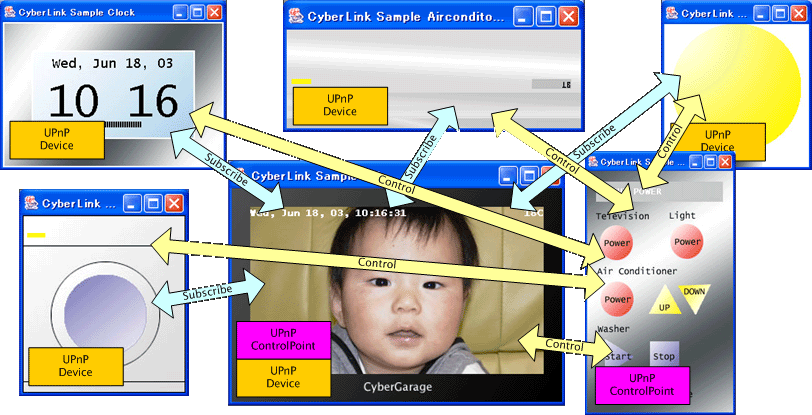

# mUPnP for C++


[](https://github.com/cybergarage/mupnp-cc/actions/workflows/make.yml)
[](http://cybergarage.github.io/mupnp-cc/)

mUPnP for C++ is a library for creating UPnP devices and control points. It provides discovery, device and service descriptions, action invocation, and event subscriptions for applications that communicate with devices on a local network.

A control point discovers and controls devices; a device application exposes services, actions, and state variables. The library supplies protocol machinery so applications can focus on those behaviors.



## Features and architecture

- SSDP discovery and device advertisement.
- XML device/service descriptions and SOAP action messages.
- GENA event subscription and notification handling.
- Supporting HTTP, socket, and threading utilities.

Public APIs are in [`include/mupnp/`](include/mupnp/), with implementations in [`src/mupnp/`](src/mupnp/). The Automake build produces `libmupnp++.a`. This repository is the C++ implementation; the separate [mUPnP for C](https://github.com/cybergarage/mupnp) project has its own history and capabilities.

## Build from source

The Unix build requires a C++ compiler, Make, POSIX threads, and an XML parser. The default parser is libxml2, located through `xml2-config`. Configuration also offers Expat and Xerces-C++ options; use `./configure --help` to inspect them. Boost headers support configurations that use Boost shared pointers, and the test build requires Boost unit-test, system, and filesystem libraries.

```sh
git clone https://github.com/cybergarage/mupnp-cc.git
cd mupnp-cc
./configure --prefix="$HOME/.local"
make
make install
```

The generated `configure` script is included. Regenerating the build system with `./bootstrap` requires Autoconf and Automake. Review the selected compiler and XML library settings if configuring on a new platform.

### Homebrew (macOS, Linux)

```sh
brew tap cybergarage/homebrew
brew install mupnp++
```

The [project tap](https://github.com/cybergarage/homebrew) provides the formula.

## Try a control point

After `make`, run the discovery example:

```sh
./examples/upnpdump/unix/upnpdump
```

Press `p` to print discovered devices and `q` to quit. SSDP discovery needs multicast connectivity to UPnP devices on the local network; firewalls and interface selection can affect results.

## Examples

The default [`examples/Makefile.am`](examples/Makefile.am) builds these examples:

| Example | Purpose |
| --- | --- |
| [`upnpdump`](examples/upnpdump/) | Discover and inspect UPnP devices as a control point |
| [`clock`](examples/clock/) | Implement a custom clock device |
| [`tv`](examples/tv/) | Implement a custom television device |

Additional [media server](examples/media/server/) and [media server inspection](examples/media/serverdump/) sources are available under `examples/media/`. They are outside the default example build and may need additional setup.

## Testing

With the XML parser and Boost dependencies installed:

```sh
./configure --enable-test
make
make check
```

Tests live in [`test/`](test/) and include XML parsing, device behavior, and networking. Network tests need usable local interfaces and permission to open sockets. See the [CI workflow](.github/workflows/make.yml) for the Linux dependency setup and coverage configuration.

## Scope and limitations

UPnP discovery and control assume a suitable local network. Included examples are starting points for application development; they do not establish certification, interoperability with every UPnP device, or readiness for public-network deployment. Validate the service profiles, parser configuration, and network behavior required by your application.

## Documentation and license

- [Programming guide and API reference (Doxygen)](https://cybergarage.github.io/mupnp-cc/)
- [BSD-style license](COPYING)
